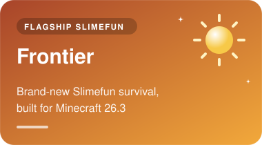
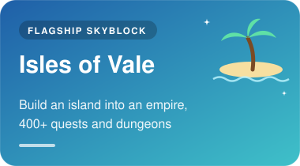
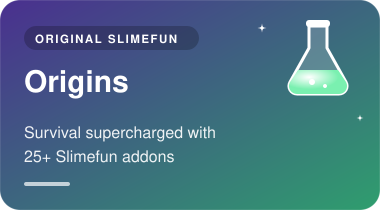

 

### Explore beyond the horizons.

Three unique worlds on one network, with cross-play for Java and Bedrock.

<table>
  <tr>
    <td align="center">
      SERVER ADDRESS 
      <code>play.beyondhorizonsmc.com</code>
    </td>
    <td align="center">
      JAVA 
      
    </td>
    <td align="center">
      BEDROCK 
      
    </td>
  </tr>
</table>

 

## 🌍 &nbsp;Choose your world

Every world is its own server, with its own progression and economy.

<table>
  <tr>
    <td width="33%" valign="top">
      
       
      📜 Ascension questline: 50 quests in 5 chapters 
      🧱 Chunk claims with per-chunk mob spawning 
      🪦 Graves instead of keep inventory 
      ⚔️ mcMMO and 72 custom enchantments 
      🛒 Rebuilt shop with every 26.3 block
    </td>
    <td width="33%" valign="top">
      
       
      🏆 400+ quests and rewarding progression 
      📈 Skills, jobs, levels and leaderboards 
      ⛏️ Minions, ore generators and spawners 
      🗡️ Dungeons, custom items and enchants 
      💰 Auctions, player shops and trading
    </td>
    <td width="33%" valign="top">
      
       
      🌲 Long-term survival world 
      🧪 Slimefun with 25+ addons 
      ⚙️ Automation, machines and technology 
      📊 Jobs and mcMMO progression 
      🏪 Player-driven economy and shops
    </td>
  </tr>
</table>

<table>
  <tr>
    <td align="center" width="160"><h2>11 years</h2>of Beyond Horizons</td>
    <td align="center" width="160"><h2>3</h2>connected game modes</td>
    <td align="center" width="160"><h2>11</h2>staff looking after you</td>
    <td align="center" width="160"><h2>Java + Bedrock</h2>cross-play on one network</td>
  </tr>
</table>

## 🛠️ &nbsp;What we build

Everything running on the three worlds is written by our team or is a fork we maintain, kept current with the latest Minecraft release.

<table>
  <tr>
    <td width="50%" valign="top">
      <h3>🧪 Slimefun</h3>
      Slimefun 4, 30+ addons we maintain for Frontier and Origins, and new addons of our own: <b>Hydraulics</b>, <b>Sentinel</b> and <b>Alembic</b>.
    </td>
    <td width="50%" valign="top">
      <h3>🏝️ Skyblock</h3>
      Our own forks of the island, minion, vault, pet and quest plugins that power Isles of Vale.
    </td>
  </tr>
  <tr>
    <td width="50%" valign="top">
      <h3>🧱 Gameplay systems</h3>
      Chunk claims, rankups, graves, tab and HUD, built to feel the same on every world.
    </td>
    <td width="50%" valign="top">
      <h3>🛰️ Network</h3>
      Cross-server utilities, diagnostics, live maps and a Discord bot that connects the community to the game.
    </td>
  </tr>
</table>

> [!NOTE]
> Our repositories are private and developed by the Beyond Horizons team. Interested in working with us? Reach out in [Discord](https://discord.gg/cTpNHJTZZ3).

## 💬 &nbsp;Get in touch

| | |
|:---:|---|
| 🎮 | **Play:** [how to join](https://beyondhorizonsmc.com/play) any of our three worlds |
| 🗳️ | **Support us for free:** [vote daily](https://beyondhorizonsmc.com/vote) for keys and rewards |
| 🐛 | **Need help?** Visit [support](https://beyondhorizonsmc.com/support) or ask in [Discord](https://discord.gg/cTpNHJTZZ3) |
| 📧 | **Business & partnerships:** [admin@beyondhorizonsmc.com](mailto:admin@beyondhorizonsmc.com) |

 

Built by the Beyond Horizons team, for the Beyond Horizons community · since 2015

